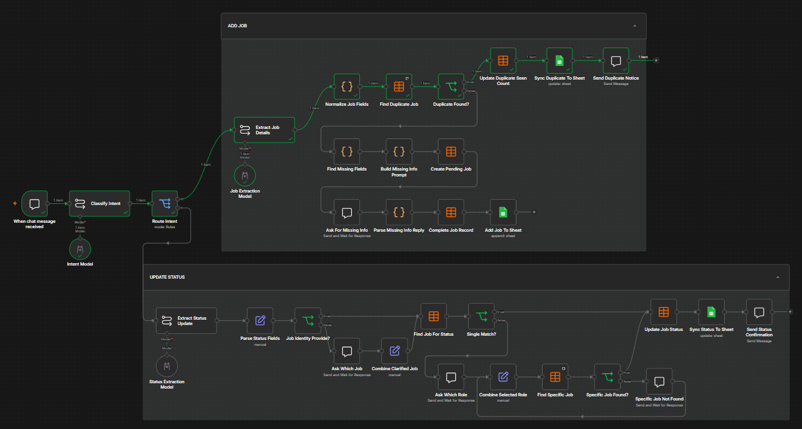

# n8n Job Application Tracker

A local job application tracker built with n8n and Ollama.

The workflow can extract job details from pasted job descriptions, detect duplicates, update application statuses, handle missing or ambiguous information, and sync records to Google Sheets.

## Features

- Job description extraction with Ollama
- Add-job and status-update intent classification
- Duplicate detection
- Missing information clarification
- Multiple-role handling for the same company
- Application status tracking
- n8n Data Table storage
- Google Sheets synchronization
- Local LLM usage without a paid AI API

## Workflow



The workflow has two main paths:

### Add Job

1. Paste a job description.
2. Extract job information.
3. Normalize company and job title.
4. Check for duplicates.
5. Ask for missing information if needed.
6. Save the job.
7. Sync it to Google Sheets.

### Update Status

You can send messages such as:

```text
Applied to [company name]
```

```text
I got an interview with [company name]
```

```text
I submitted the [company name] assessment
```

If multiple roles exist for the same company, the workflow asks which role you mean before updating the record.

## Tech Stack

- n8n
- Ollama
- Llama 3.2 3B
- Google Sheets
- n8n Data Tables
- JavaScript

## Project Structure

```text
n8n-job-application-tracker/
├── README.md
├── workflow/
│   └── job-application-tracker.json
├── screenshots/
│   └── workflow-overview.png
└── .gitignore
```

## Requirements

- n8n
- Ollama
- Llama 3.2 3B
- Google account for Google Sheets

## Privacy

The repository does not include credentials, API keys, private Google Sheets data, or personal application records.

## Future Improvements

- Webhook/API access
- Better form-based input
- Dashboard and analytics
- Improved fuzzy matching